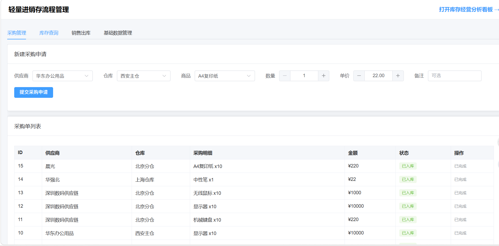
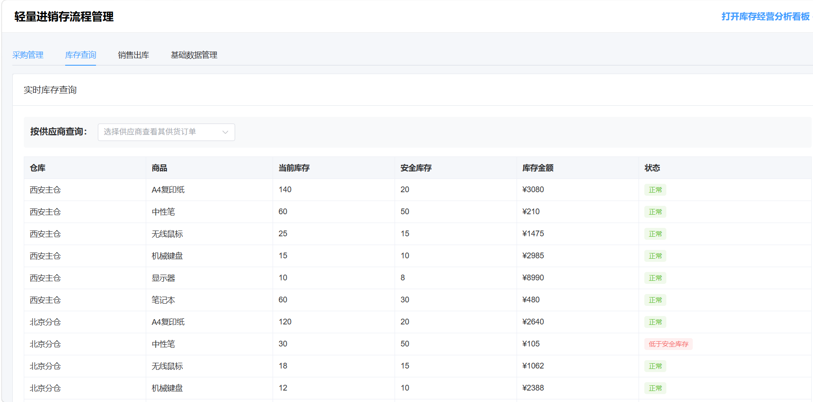
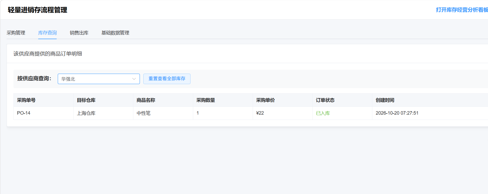
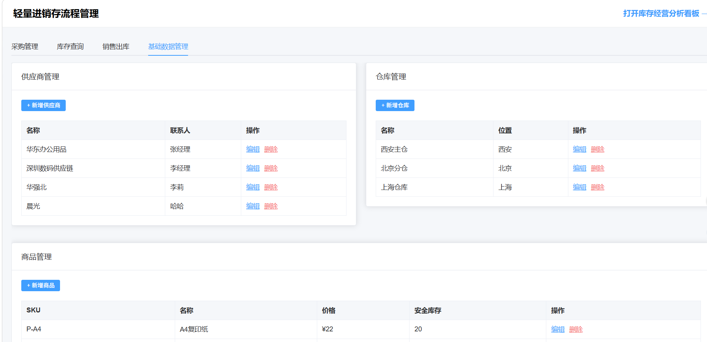
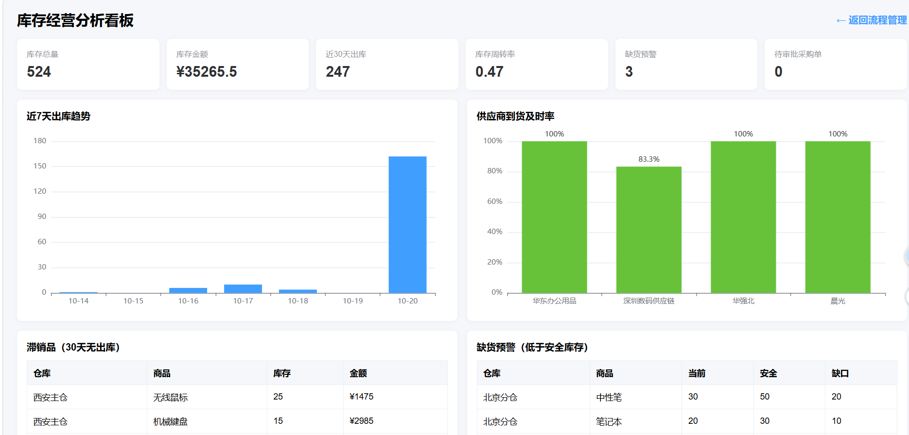
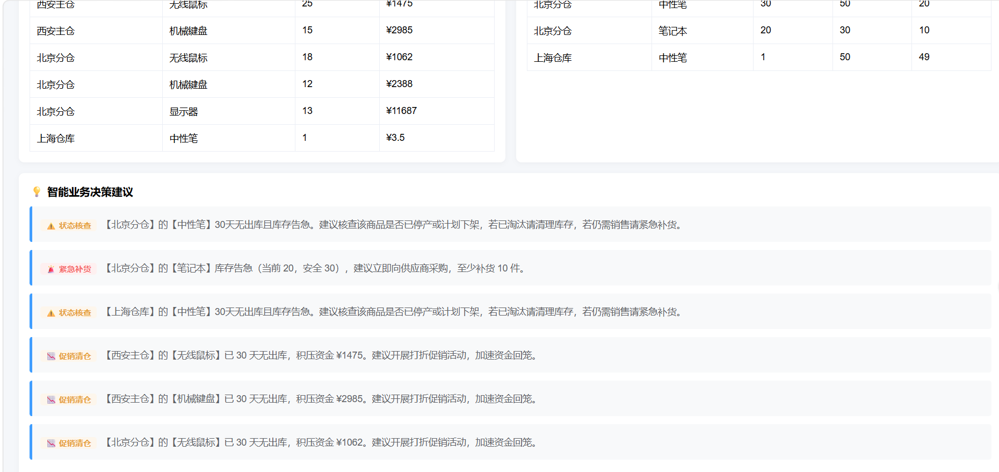
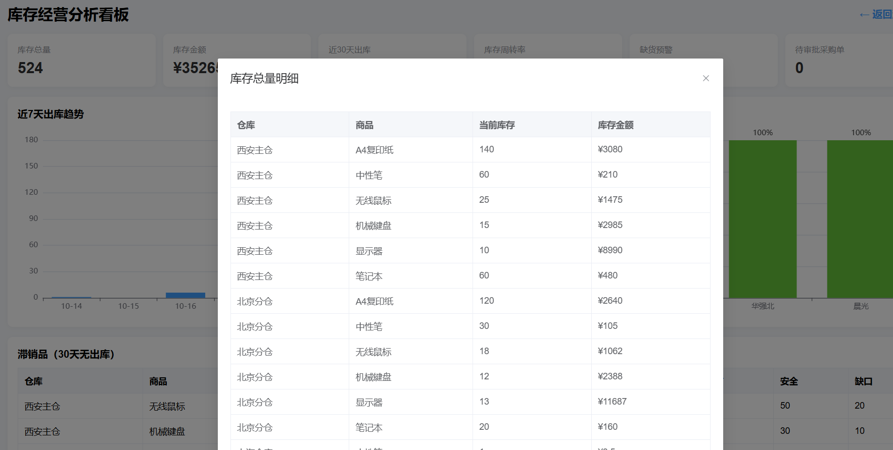

# 📦 小微零售进销存与库存经营分析系统

针对小微零售“多仓库库存不一致、采购审批靠微信、库存周转看不清”等问题，设计了一套单据驱动、审批可配置、分析可下钻的轻量级进销存与分析组合系统。

## 项目演示

## ✨ 核心功能
- **流程管理**：采购申请 -> 多级审批 -> 采购入库 -> 销售出库 -> 库存实时扣减。
- **数据看板**：库存周转率、缺货预警、滞销品分析、供应商到货及时率，图表使用 ECharts 渲染。
- **供应商穿透查询**：支持按供应商维度动态追踪其历史供货订单明细。
- **智能决策支持**：系统内置规则引擎，自动根据库存结构生成“紧急补货”、“促销清仓”及“异常状态核查”的辅助决策建议。

## 🛠️ 技术栈
- **后端**：Python, FastAPI, SQLAlchemy, SQLite
- **前端**：Vue3, Element Plus, ECharts
- **架构**：前后端分离（前端使用 CDN 引入，无需 Node.js 构建）

## 🚀 本地运行指南
1. 克隆本项目并进入目录： git clone <你的仓库地址>
   cd inventory-bi/backend
2. 创建并激活虚拟环境：python -m venv .venv
# Windows
.venv\Scripts\activate
3. 安装依赖：pip install -r requirements.txt -i https://pypi.tuna.tsinghua.edu.cn/simple
4. 初始化数据：python seed.py
5. 启动服务：uvicorn app.main:app --reload
流程管理：http://127.0.0.1:8000/
   · 分析看板：http://127.0.0.1:8000/dashboard.html
   